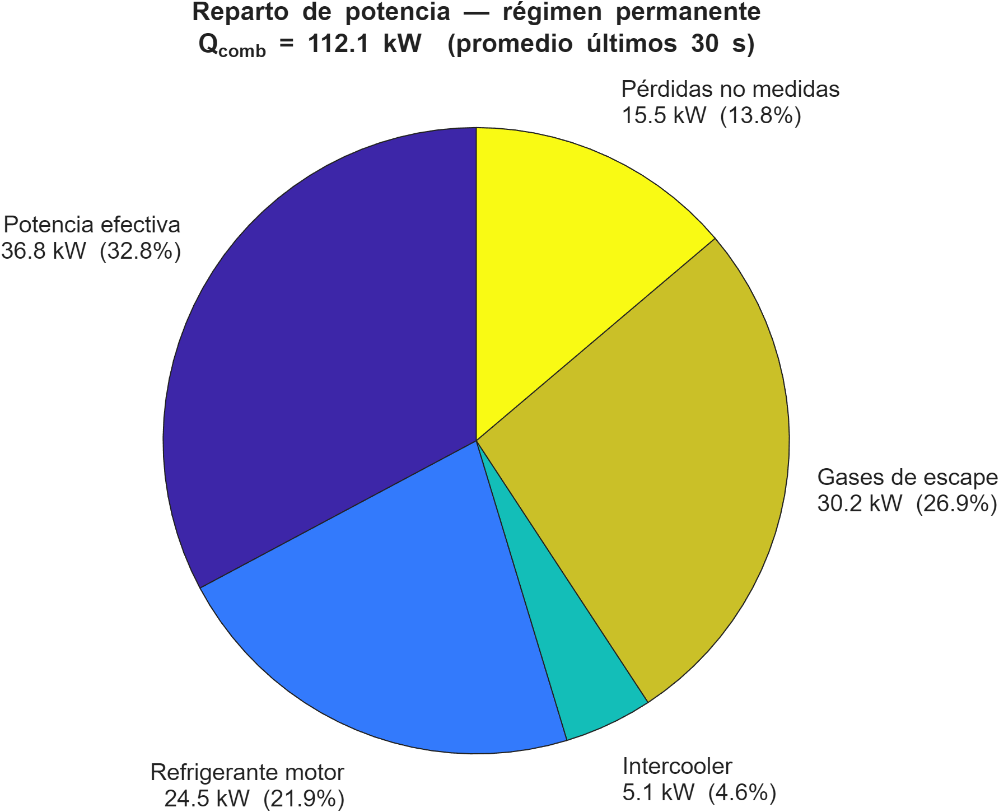
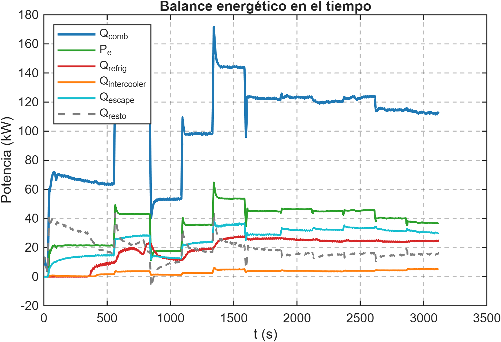
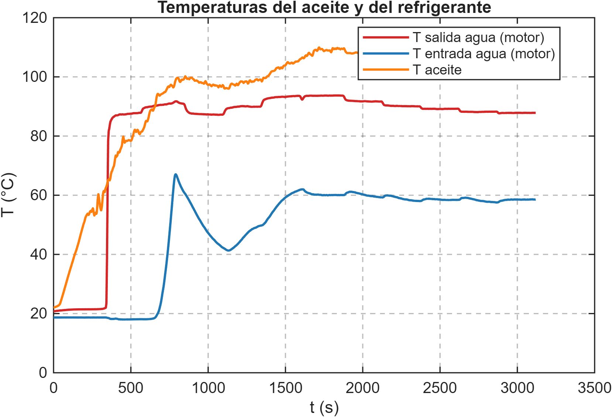
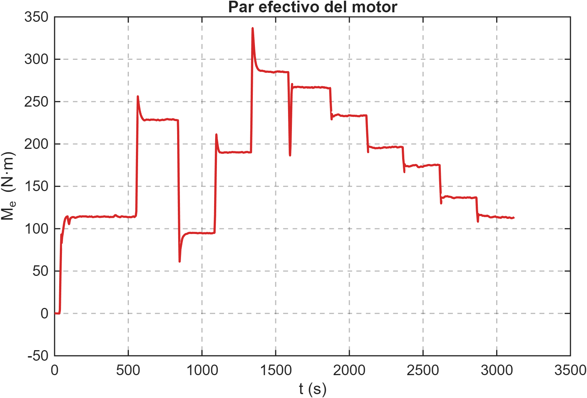
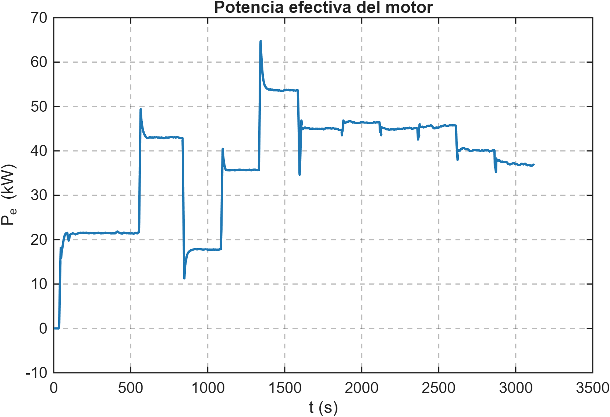
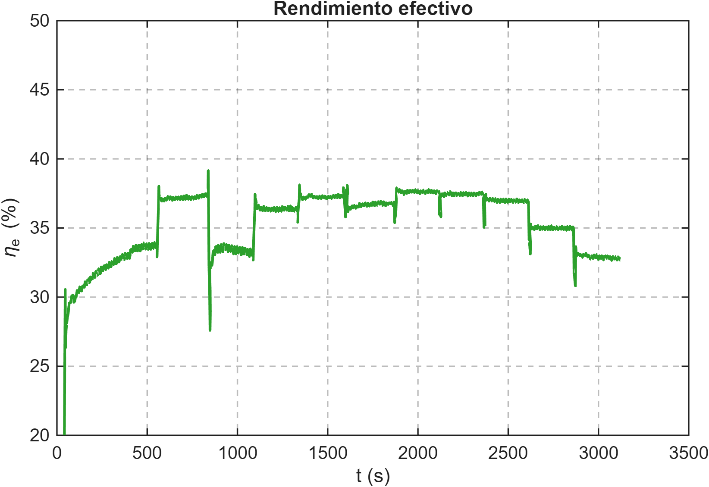
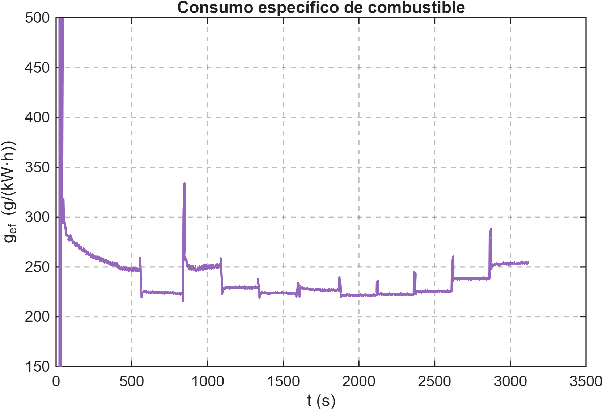

# Ensayo de un motor diésel turbo en banco de pruebas

Procesado en **MATLAB** de los datos de un ensayo en banco de un motor diésel **Nissan YD** de 4 cilindros, con turbocompresor e intercooler, realizado en el Laboratorio de Motores Térmicos de la ETSII – Universidad Politécnica de Madrid.

📄 Proyecto completo, con la explicación de los resultados: **[mboulman.com](https://mboulman.com)** → carpeta *Motores y automoción*

## Resultados principales

| Magnitud | Valor |
|---|---|
| Potencia efectiva máxima | ~65 kW (plena carga, ~1800 rpm) |
| Par máximo | ~335 N·m |
| Rendimiento efectivo máximo | 37,5 % |
| Consumo específico mínimo | ~221 g/kWh |
| Presión de sobrealimentación | hasta ~2,2 bar absolutos |

**Balance energético en régimen permanente** (3100 rpm, acelerador a fondo, media de los últimos 30 s): el combustible aporta 112,1 kW, de los que el 32,8 % es potencia efectiva, el 26,9 % se va con los gases de escape, el 21,9 % al refrigerante, el 4,6 % al intercooler y el 13,8 % son pérdidas no medidas.

## El ensayo

- **Motor:** diésel de 4 cilindros en línea, 89 mm de diámetro y 100 mm de carrera, con turbocompresor e intercooler.
- **Banco:** freno dinamométrico de corrientes de Foucault y adquisición con LabVIEW de 29 canales cada 0,1 s.
- **Tres partes:** arranque en frío hasta la estabilización térmica (~1800 rpm), barrido del grado de carga a régimen constante y barrido del régimen de 1600 a 3100 rpm con el acelerador a fondo.

## Qué hace el código (`ensayo_motor.m`)

1. Importa el fichero de LabVIEW con `readtable` y asigna nombres cortos a cada canal.
2. Calcula de forma vectorizada la potencia efectiva, los gastos másicos de aire y combustible, el dosado relativo, el rendimiento volumétrico y efectivo, el consumo específico y cada término del balance energético, con un cp de los gases de escape que depende del dosado.
3. Suaviza las señales con una media móvil de 10 s y promedia los últimos 30 s para el régimen permanente.
4. Genera 20 figuras con un estilo común y las exporta a 300 ppp con `exportgraphics`.

## Figuras

| | |
|---|---|
|  |  |
|  |  |
|  |  |

## Cómo ejecutarlo

El script espera el fichero de datos del ensayo (`Grupo 4 MT2026.xlsx`) en la misma carpeta. **Los datos no se incluyen en este repositorio**, porque los proporcionó el profesor de la asignatura. Con ese fichero, basta con abrir `ensayo_motor.m` en MATLAB y ejecutarlo; las figuras se guardan en la carpeta `Imagenes_Pract_2`.

---

🇬🇧 <b>English summary</b>

MATLAB processing of test-bench data from a 4-cylinder **Nissan YD** turbocharged diesel engine with intercooler, tested at the Internal Combustion Engines Laboratory of ETSII – Universidad Politécnica de Madrid.

- **Maximum brake power** ~65 kW and **maximum torque** ~335 N·m at full load (~1800 rpm).
- **Maximum brake efficiency** 37.5 %, **minimum specific fuel consumption** ~221 g/kWh.
- **Energy balance** at 3100 rpm, full throttle: 32.8 % brake power, 26.9 % exhaust, 21.9 % coolant, 4.6 % intercooler, 13.8 % unmeasured losses.

The script imports the 29-channel LabVIEW file, computes performance, efficiencies, fuel-air ratio and the full energy balance, and exports 20 figures at 300 dpi. The test data are not included (provided by the lecturer).

Full project: **[mboulman.com](https://mboulman.com)**

---

Mohamed Boulman Mokhlis · Motores Térmicos, ETSII-UPM · © 2026, todos los derechos reservados.
